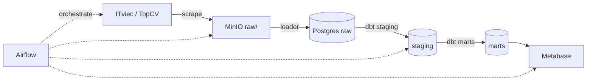

# Data Job Market Pipeline

End-to-end ELT pipeline for the Vietnamese IT job market: scrape → raw object storage → Postgres → dbt star schema → dashboard, orchestrated by Airflow.

> Status: **Day 1 — infrastructure skeleton**. Ingestion, dbt models and DAGs land in the following days.

## Kiến trúc (mục tiêu)



## Tech stack

| Layer | Tool |
|---|---|
| Ingestion | Python 3.12, requests / BeautifulSoup |
| Storage | MinIO (S3-compatible) |
| Warehouse | PostgreSQL 16 |
| Transformation | dbt (postgres adapter) |
| Orchestration | Apache Airflow |
| BI | Metabase |
| Quality | dbt tests + Great Expectations |
| CI | GitHub Actions |

## Quickstart

Yêu cầu: Docker Desktop đang chạy, Python 3.12 (`/opt/homebrew/bin/python3.12`).

```bash
make up        # start Postgres + MinIO, create .env, create bucket "raw"
make install   # create .venv and install dependencies
make test      # run pytest
```

Kiểm tra:

```bash
make psql                 # psql shell -> \dn  (thấy schema raw, analytics)
open http://localhost:9001  # MinIO console (minioadmin / minioadmin)
```

Tắt:

```bash
make down      # stop, keep data
make clean     # stop + delete volumes (destructive)
```

## Cấu trúc repo

```
.
├── docker-compose.yml      # postgres + minio + minio-init
├── Makefile                # up / install / test / lint / psql
├── docker/init/            # SQL chạy lần đầu khi Postgres khởi tạo
├── ingestion/              # scraper, parser, loader (Python)
├── dags/                   # Airflow DAGs
├── dbt/                    # dbt project (models, tests, docs)
├── quality/                # Great Expectations suites
├── bin/                    # helper: docker credential bypass
├── docs/                   # source notes, screenshots, ERD
└── .github/workflows/      # CI
```

## Quyết định thiết kế

- **raw là JSONB, không phải bảng cột**: giữ nguyên payload gốc để có thể re-parse khi parser thay đổi; mọi việc làm sạch nằm ở dbt staging.
- **Khoá tự nhiên = sha256(url)**: URL job ổn định, chống trùng khi scrape lại; loader idempotent bằng `ON CONFLICT`.
- **MinIO thay vì ghi file local**: mô phỏng S3 thật, cùng code chạy được trên cloud sau này.
- **Schema `raw` tách khỏi `analytics`**: phân quyền đọc/ghi rõ ràng, dbt không bao giờ ghi vào raw.

## Ghi chú môi trường

- Docker Desktop phải đang chạy (`open -a Docker`).
- Trong phiên sandbox của DSH, Keychain không truy cập được → `make` đã tự trỏ `DOCKER_CONFIG` sang helper `bin/docker-credential-null` để pull image public. Chỉ dùng cho registry public.
- Lộ trình 24 ngày: xem `../data-engineering-roadmap-24-days.md`.
