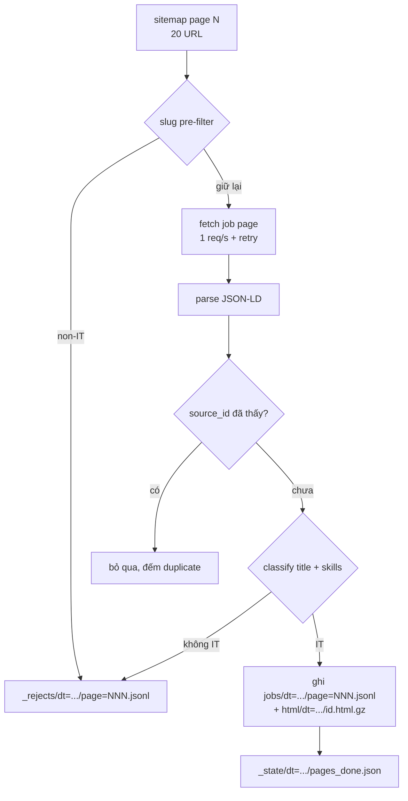

# Báo cáo Ngày 3 — Crawler cho raw zone

> Mục tiêu: từ script thăm dò (Ngày 2) → crawler thật, chạy được, chạy lại không trùng, đứt giữa chừng chạy tiếp được.
> Ngày: 2026-11-26 · Thời gian thực hiện: ~2h · Chi phí API: **$0** (chỉ dùng MinIO local).

---

## 1. Kết quả cuối ngày

| Hạng mục | Trạng thái |
|---|---|
| `config.py` — cấu hình tập trung | ✅ |
| `storage.py` — lớp S3 + quy ước key | ✅ |
| `filter.py` — bộ lọc job IT | ✅ |
| `scrape.py` — crawler có resume | ✅ |
| Unit test | ✅ **42 test** (từ 6 lên 42) |
| Chạy thật lên MinIO | ✅ xem mục 7 |
| Idempotent + resume | ✅ đã kiểm chứng |
| Commit | ✅ |

---

## 2. Luồng dữ liệu



### Bố cục object trên MinIO
```
raw/
├── jobs/dt=2026-11-26/page=001.jsonl      # chỉ job IT, mỗi dòng 1 job
├── html/dt=2026-11-26/2138855.html.gz     # HTML gốc để re-parse
├── _rejects/dt=2026-11-26/page=001.jsonl  # tiêu đề bị loại + lý do (để tinh chỉnh)
├── _state/dt=2026-11-26/pages_done.json   # resume
└── _meta/dt=2026-11-26/run_summary.json   # số liệu 1 lần chạy
```

Điểm quan trọng: **partition theo `dt`**. Mỗi ngày một thư mục riêng → chạy lại hôm nay chỉ ghi đè hôm nay, không bao giờ đụng dữ liệu hôm qua.

---

## 3. Bốn quyết định thiết kế

| # | Quyết định | Vì sao |
|---|---|---|
| 1 | **20 trang/ngày** (400 job) thay vì full 9.600 | Pipeline chạy trong vài phút, đúng nhịp "daily job"; backfill 1 lần riêng khi cần |
| 2 | Lưu **JSONL theo trang** + **HTML gz theo job** | JSONL gọn để xử lý; HTML để re-parse khi sửa parser — đúng lý do tồn tại của lớp raw |
| 3 | **Ghi một lần theo `dt`**, không upsert ở storage | Raw là lịch sử; trạng thái "mới nhất" do warehouse (Postgres) quản ở Ngày 4 |
| 4 | Resume bằng **state file**, không quét lại storage | Biết chính xác trang nào xong, không phải list hàng trăm object mỗi lần chạy |

---

## 4. Code walkthrough

### `ingestion/config.py`
- `BaseSettings` của pydantic đọc `.env`, không hard-code endpoint.
- `get_settings()` có `@lru_cache` → đọc env **một lần** trong vòng đời process; test có thể truyền `Settings(...)` riêng.
- Tách khỏi code để sau này chuyển MinIO → S3 thật chỉ cần đổi env.

### `ingestion/storage.py`
- `ObjectStore` bọc boto3. Toàn bộ code khác gọi `store.put_jsonl(...)`, không ai gọi boto3 trực tiếp.
- **Key builder là hàm thuần** (`jobs_key`, `html_key`, `state_key`, `meta_key`, `rejects_key`) → test được mà không cần S3. Đây là hợp đồng với loader Ngày 4.
- `put_jsonl` ghi mỗi dòng một JSON (không phải mảng) → loader đọc streaming được, file lớn vẫn ổn.
- `delete_prefix()` thêm vào để **reprocess một ngày**: xoá rồi crawl lại. Đây là thao tác sẽ dùng nhiều khi sửa parser.

### `ingestion/filter.py`
Hai tầng:
1. **Negative** (chỉ xét title): telesales, kinh doanh, tuyển sinh, kế toán, data entry… → loại ngay.
2. **Positive** (title + skills): developer, java, python, devops, sql, sharepoint, "lập trình", "phần mềm", "dữ liệu"… → giữ.

Chi tiết quan trọng:
- `normalize()` bỏ dấu tiếng Việt (`Lập trình viên` → `lap trinh vien`) và `đ→d`, nên **một** danh sách keyword phủ cả hai cách viết.
- Giữ nguyên `c++`, `c#`, `.net` khi normalize (regex cho phép `+#.`).
- Trả về `(bool, reason)` — lý do được lưu vào dữ liệu để **audit** về sau.
- Negative xét **trước** positive: "Nhân viên kinh doanh phần mềm" bị loại dù có chữ "phần mềm".

### `ingestion/scrape.py`
- `crawl_page()` là một đơn vị công việc trọn vẹn cho 1 trang sitemap: lấy URL → lọc → fetch → parse → classify → ghi.
- **Fail soft**: lỗi 1 job chỉ thêm warning, không làm chết cả trang; lỗi cả trang thì đánh dấu `failed` và đi tiếp.
- **Pre-filter theo slug**: slug URL chứa tiêu đề, nên nếu slug đã là "kinh doanh/tư vấn/kế toán" thì **không gọi mạng** — tiết kiệm ~35–60% request.
- `seen_ids` là set trong bộ nhớ để chống trùng **giữa các trang** trong cùng một lần chạy.
- State được ghi **sau mỗi trang** → crash giữa chừng vẫn giữ tiến độ.
- `--dry-run` in kế hoạch mà không gọi mạng.

---

## 5. Ba phát hiện dữ liệu quan trọng

### 5.1 `identifier.value` là ID công ty, không phải ID job ⚠️
Lần chạy đầu cho ra 40 job nhưng **38 trùng** — bất thường. Nguyên nhân:

```json
"identifier": {"name": "MBBANK", "value": 94346},
"potentialAction": {"target": ".../tap-su-...-mbbank-2141967"}
"hiringOrganization": {"sameAs": ".../companies/mbbank-94346"}
```

`94346` trùng với đuôi URL **công ty** → đó là `company_id`. MBBANK đăng cùng một vị trí cho 20 địa điểm, mỗi địa điểm là một job riêng (id 2141967, 2141961, …) nhưng cùng company id → bị gộp sai.

**Sửa**: `source_id` lấy từ đuôi số của URL job (`-2138855`), `company_id` lưu riêng để làm `dim_company` sau này.
**Bài học**: khoá tự nhiên phải là thứ *duy nhất theo bản ghi*, không phải thứ "trông giống ID". Khi thấy tỷ lệ duplicate bất thường (38/40), đó là tín hiệu bug chứ không phải dữ liệu xấu.

### 5.2 Sitemap mới nhất bị "spam" job ngân hàng
10 trang đầu (200 job): 35% bị loại sớm, chỉ ~2% là IT rõ ràng, 62% trung tính. MBBANK/ngân hàng đăng hàng loạt vị trí tư vấn khách hàng cho từng chi nhánh.

**Hệ quả**: 20 trang/ngày có thể chỉ ra 10–30 job IT. Dashboard cần **backfill vài trăm trang** một lần để có dữ liệu xu hướng, sau đó chạy incremental hằng ngày.

### 5.3 Trang search cũng SSR nhưng không đủ tốt
`/jobs/search?keyword=java` trả ~9–15 link/trang và lẫn job không liên quan (kế toán, MBBANK). Không ổn định bằng sitemap nên **không dùng** làm nguồn chính — chỉ ghi lại làm phương án dự phòng.

---

## 6. Idempotency & resume — chứng minh thế nào

Ba kịch bản phải kiểm tra:

```bash
# 1) chạy lại cùng ngày -> không crawl lại trang đã xong
python -m ingestion.scrape --pages 40
# kỳ vọng: "nothing to do: all pages finished for this date"

# 2) xoá state của 1 trang -> chỉ crawl lại trang đó
#    (hoặc dùng delete_prefix để reprocess cả ngày)

# 3) Ctrl+C giữa chừng rồi chạy lại
#    kỳ vọng: "already_done=[1,2,3]" và tiếp tục từ trang 4
```

Cơ chế: mỗi trang xong → `save_state()` ngay. Vì state ghi sau từng trang, mất điện cũng chỉ mất tối đa 1 trang.

---

## 7. Kết quả chạy thật

### 7.1 Lần chạy đầu — phát hiện bug khoá

| Chỉ số | Giá trị |
|---|---|
| Trang crawl | 2 (40 job) |
| Job IT | **1** |
| Trùng | **38/40** ⚠️ |

Tỷ lệ trùng 95% là bất thường → truy ra `identifier.value` là **company id** (mục 5.1). Đã sửa: `source_id` lấy từ đuôi URL. Xoá partition ngày hôm đó và crawl lại.

### 7.2 Chạy lại sau khi sửa + thêm pre-filter theo slug

Lệnh: `python -m ingestion.scrape --pages 40`

| Chỉ số | Giá trị |
|---|---|
| Trang | 38 (trang 1–2 đã xong trước đó) |
| Job đọc từ sitemap | 760 |
| Bị bỏ sớm theo slug (không gọi mạng) | **333 (44%)** |
| Job IT giữ lại | 20 |
| Bị loại bởi filter | 713 |
| Trùng | 26 |
| Thời gian | **737,5s (~12 phút)**, 0 trang lỗi |

### 7.3 Reclassify bằng filter v2 (không crawl lại)

Sau khi đo precision, phát hiện 10/21 job "IT" thực ra là **QC nhà máy / kho vận / HVAC / tài chính** — do keyword `qa`, `qc`, `engineer`, `du lieu` quá rộng.

| Bước | Số record |
|---|---|
| Trước reclassify | 21 |
| Sau reclassify (v2) | **11** |
| Chuyển sang `_rejects/` | 10 |

11 job còn lại đều đúng là IT: AI Full Stack Engineer, Pentest specialist, Cobol Developer, Android Developer, IT Business Analyst ×2, Business Analyst, M365/Copilot specialist, security operations, ERP/IT PM, automation QA.

Điểm hay: **không cần crawl lại** — reclassify đọc từ raw đã lưu. Đây chính là lý do phải có lớp raw.

### 7.4 Trạng thái MinIO sau Ngày 3

| Prefix | Số object |
|---|---|
| `jobs/dt=2026-11-26/` | 40 file JSONL |
| `html/dt=2026-11-26/` | 21 file `.html.gz` |
| `_rejects/dt=2026-11-26/` | 40 file (audit trail) |
| `_state/` | 1 file, 40 trang done |
| `_meta/` | 1 file run summary |


---

## 8. Test (31 test)

| File | Số test | Nội dung |
|---|---|---|
| `test_smoke.py` | 1 | import đủ dependency |
| `test_explore.py` | 6 | parser JSON-LD: lương khoảng, "Thoả thuận", skills, địa điểm, job id từ URL |
| `test_storage.py` | 3 | quy ước key (zero-pad, partition) |
| `test_filter.py` | 27 | 11 job IT phải giữ, 13 job không-IT phải loại (gồm 8 ca thực tế), normalize tiếng Việt |
| `test_scrape.py` | 5 | lọc + reject trail, dedupe, lỗi sitemap, state, pre-filter |

Tổng: **42 test**.

Điểm đáng chú ý: test dùng **HTML thật** đã lưu (fixture gzip), không phải dữ liệu tự bịa → parser không bị "test giả".

---

## 9. Câu hỏi phỏng vấn & trả lời mẫu

**Q1. Làm sao pipeline chạy lại không bị nhân đôi dữ liệu?**
> "Ba lớp. Ở storage, mọi thứ ghi theo partition `dt` nên chạy lại cùng ngày là ghi đè, không append. Ở mức bản ghi, em dedupe theo `source_id` — ID job lấy từ URL, không phải `identifier` của JSON-LD vì field đó là ID công ty. Ở warehouse (Ngày 4) sẽ là `INSERT ... ON CONFLICT (source_id) DO UPDATE`."

**Q2. Nếu job bị xoá khỏi sitemap thì sao?**
> "Raw vẫn giữ bản ghi ngày cũ. Ở tầng warehouse em dùng `valid_through` và `last_seen_at` để đánh dấu `is_active`, không xoá cứng — cần lịch sử để phân tích xu hướng."

**Q3. Crawler chết giữa chừng thì xử lý thế nào?**
> "State lưu sau từng trang nên chạy lại chỉ làm tiếp phần còn thiếu. Mỗi job lỗi chỉ ghi warning, không kill cả trang; trang lỗi được đưa vào `failed_pages` để retry lần sau."

**Q4. Vì sao lưu cả HTML nếu đã có JSON?**
> "Để re-parse. Nếu em phát hiện parser bỏ sót field, em chạy lại parser trên HTML cũ mà không cần crawl lại — tiết kiệm request và giữ được dữ liệu lịch sử."

**Q5. Sao không crawl song song cho nhanh?**
> "Vì em tôn trọng rate limit của nguồn: 1 req/s là mức lịch sự. Muốn nhanh hơn thì tăng số trang mỗi lần chạy hoặc backfill ngoài giờ, chứ không bắn song song."

---

## 9.5 Bài học về precision

Lần đầu mình tin rằng "lọc theo keyword là xong". Thực tế precision chỉ ~50% vì:
- `qa`/`qc` khớp **QC nhà máy** (PQA, QE, ISO, gia công).
- `engineer` khớp **kỹ sư HVAC**, kỹ sư chất lượng.
- `du lieu` khớp **nhập liệu kho**.
- `erp` khớp job tài chính có dùng ERP.

Cách sửa đúng: **đo precision trên dữ liệu thật, rồi siết từ khoá** (dùng cụm cụ thể thay vì từ đơn), thêm negative cho ngành gần giống. Và luôn lưu `filter_reason` + `_rejects/` để lần sau chỉnh có bằng chứng.

## 10. Bài học

1. **Luôn nhìn tỷ lệ duplicate** — 38/40 là bug, không phải "dữ liệu bẩn".
2. **Khoá tự nhiên phải kiểm chứng bằng dữ liệu**, đừng tin tên field (`identifier` nghe như ID job nhưng không phải).
3. **Pre-filter rẻ trước, fetch đắt sau**: lọc theo slug tiết kiệm hàng trăm request.
4. **Fail soft + state sau mỗi đơn vị việc** là thứ biến script thành pipeline.
5. **Lưu lý do loại** (`_rejects/`) để tinh chỉnh bằng bằng chứng, không bằng cảm tính.

## 11. Việc Ngày 4 (chuẩn bị)

- [ ] `ingestion/load.py`: đọc `jobs/dt=*/page=*.jsonl` → `INSERT ... ON CONFLICT (source_id) DO UPDATE` vào `raw.job_postings (source_id PK, dt, payload JSONB, crawled_at)`.
- [ ] Idempotent: chạy 2 lần → `0 inserted, N updated`.
- [ ] `last_seen_at` để biết job còn tồn tại.
- [ ] Test: dùng Postgres thật trong Docker (hoặc testcontainers).
